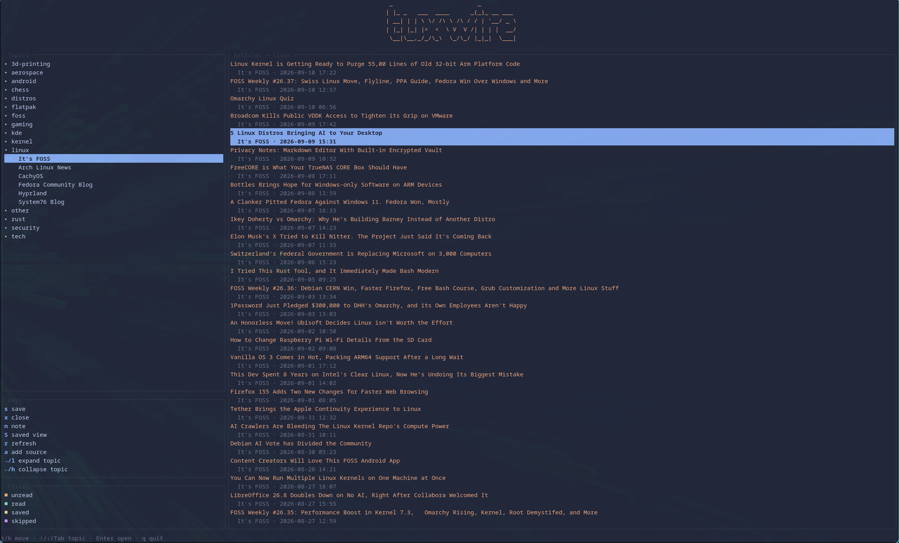
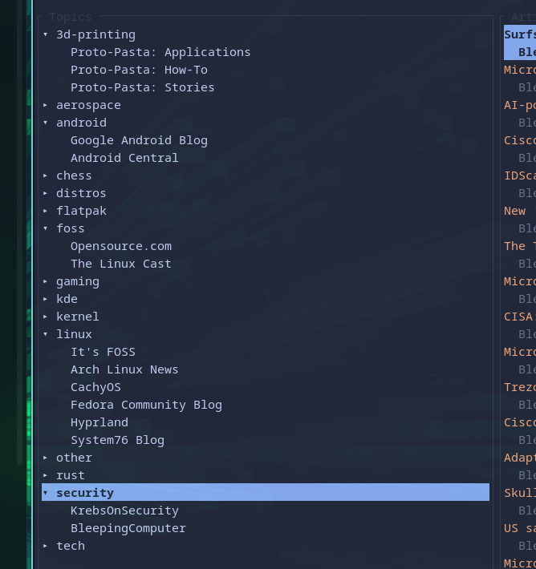
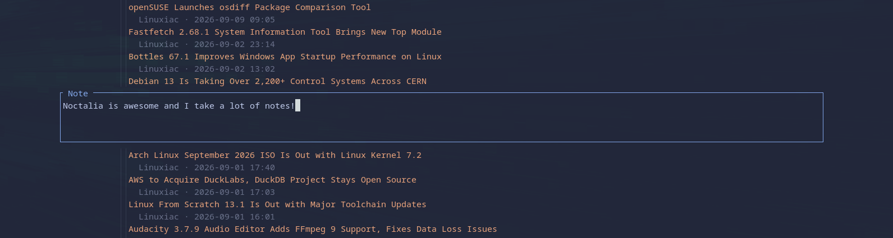
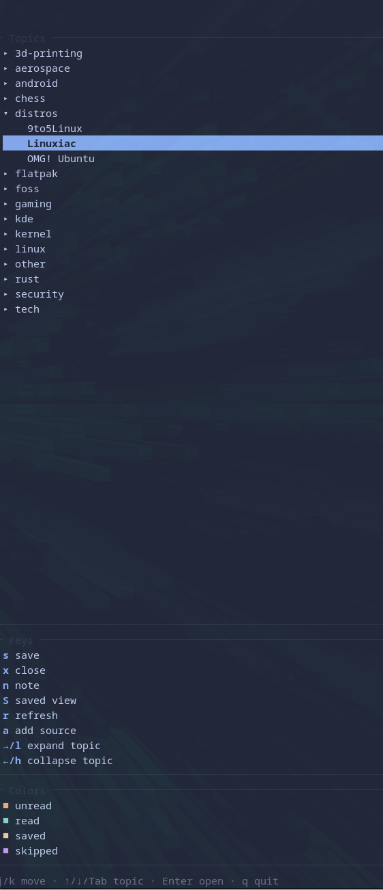
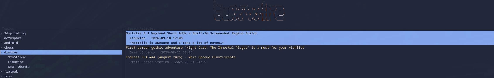
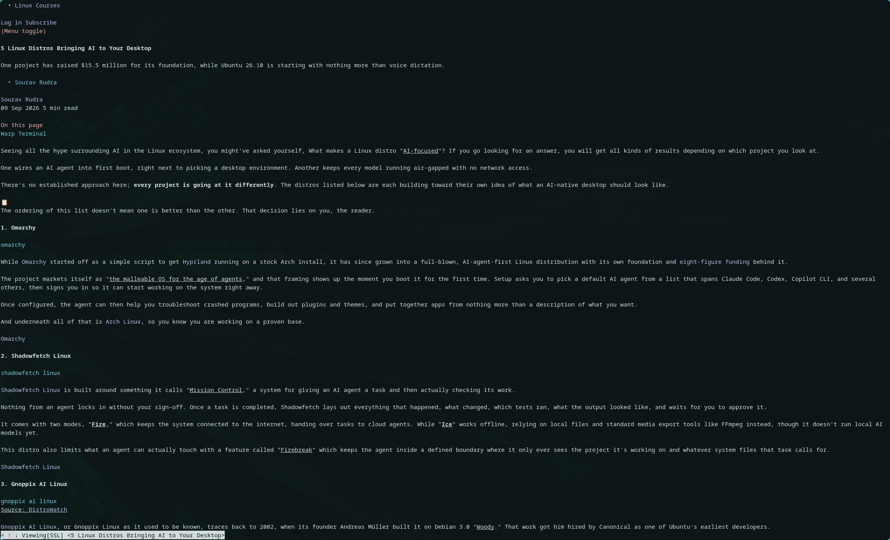
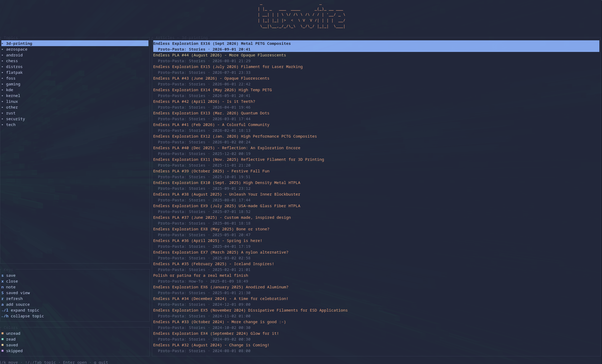

# tuxwire

A terminal-based RSS/Atom reader for people who take notes while they read.

tuxwire pulls articles from any feeds you choose — Linux news, security
advisories, your own blog, or anything else with an RSS feed — into a
single fast, themeable terminal interface. Save the articles that matter,
write a note explaining *why* they mattered, and find them again later —
without ever leaving the terminal.

<p align="center">
  
</p>

---

## Why tuxwire

Most RSS readers are either a GUI app or a terminal reader with no memory
of *why* you saved something. tuxwire exists for the gap in between: a
fast, keyboard-driven reader that also lets you jot down a thought next
to an article — "try this on mangrove," "reference this for the blog
post" — and actually find that note again days or weeks later.

---

## Features

### Multi-source aggregation, fully editable
Pull from as many RSS/Atom feeds as you want, grouped into topics you
define yourself — not a fixed category list. Add a source by pressing `a`
inside the app (paste a feed URL or just a blog's address, tuxwire finds
and validates the feed, pick or type a topic), or edit `~/.config/tuxwire/sources.toml` directly in a text
editor. Either way, the file is yours to read and change at any time.

### Expandable topic tree
The sidebar isn't a flat list — each topic can be expanded to show the
individual sources feeding it. Select a topic to see everything in that
category, or drill into one specific source to see just its articles.

<p align="center">
  
</p>

### Save articles with notes
Press `s` to save an article permanently (it also marks it read). Press
`n` to attach a note — a short reminder of why it mattered. Notes are
edited in a simple popup, pre-filled if one already exists. tuxwire
tracks both *when you saved* an article and *when you last wrote or
edited its note* as separate dates, since those are often different
moments.

<p align="center">
  
</p>

### A persistent, always-visible legend
No need to memorize what a key does or what a color means. The sidebar
permanently displays the active keybinds and each article state's icon
(unread, new, read, saved, skipped) in that state's color — pulled live
from your actual theme and icon mode, so it never drifts out of sync with
what you're seeing.

### Nerd Font icons, with plain fallbacks
Every article row, sidebar topic, and status message gets an icon:
unread/new/read/saved/skipped markers, a per-category icon for each topic
(Linux, Rust, security, news, sports, ...), and refresh/error/offline
notices. Three modes — Nerd Font, plain Unicode, or ASCII — switchable
live with `i`. On first run tuxwire shows a test glyph and asks whether
you can see it, falling back to Unicode if not.

<p align="center">
  
</p>

### Multiple feed lists
Keep more than one feed list, e.g. a **main** list you read daily and a
**casual** list for lower-priority feeds, and switch between them with
`f`. The picker shows each list's name, file, and unread count, and
switching is instant (nothing is refetched until you press `r`). Read,
saved, and note state are shared: an article read in one list is read
everywhere. Saved, History, and search always cover every list. The
footer shows the active list's file ("Feed List: ~/.config/tuxwire/…").
With a single list, none of this shows up and tuxwire works as it
always has.

### Saved view, History view, and search
- `S` — every saved article across all topics, with source, save date,
  and a note preview.
- `y` — every article tuxwire has ever fetched, regardless of state —
  useful for finding something you read but forgot to save.
- `/` — live substring search across titles and notes, filtering
  whichever view is currently open.

<p align="center">
  
</p>

### In-terminal reading via w3m, with automatic fallback
If [w3m](https://w3m.sourceforge.net/) is installed, pressing `Enter`
opens the article right inside your terminal — no context switch to a
browser. If w3m isn't installed, tuxwire automatically falls back to
your regular default browser instead. Nothing breaks either way.

<p align="center">
  
</p>

### Export your saved articles to Markdown
Press `S` to open the Saved view, then `E` to export everything you've saved into a
single Markdown file: saved articles without a note first, as a short list,
then your notes, each with its title, source link, dates and the note in full.
Set `include_unnoted = false` in `export.toml` to export only the notes.
Configurable output location, useful for feeding notes straight into a blog
post or personal wiki.

### Move your feeds in and out (OPML)
Other feed readers use OPML files to move a feed list around. From the
terminal:

```bash
tuxwire import-opml feeds.opml          # add the feeds in the file
tuxwire export-opml my-feeds.opml       # save your feeds as a file
tuxwire export-opml - | less            # "-" prints to the screen
```

With several feed lists, add `--list NAME` to pick one; without it the list you
used last is used. Importing skips feeds you already have, keeps the comments in
your `sources.toml`, and downloads nothing: the new feeds' articles arrive the
next time you open tuxwire. Exporting never overwrites an existing file.

### Eight built-in themes, plus your own colors
Everforest (default), Dracula, Gruvbox, Catppuccin Mocha, Nord, Solarized
Dark, Tokyo Night, and Catppuccin Macchiato (tuxwire's original palette).
Press `t` to open the picker: the whole screen previews each theme live as
you move, `Enter` keeps it, and the choice is remembered across restarts.
Every theme is tested for readable text and clearly distinct article-state
colors. Any color can still be overridden in `~/.config/tuxwire/theme.toml`,
on top of whichever theme you pick.

### Cross-platform
Runs anywhere Rust runs — tested on desktop Linux and on Android via
[Termux](https://termux.dev/). Same codebase, same database format,
same features.

---

## Installation

tuxwire isn't published to any package manager yet — for now, build it
from source. This is more approachable than it sounds; the steps below
assume no prior experience.

### 1. Install Rust

If you don't already have Rust installed:

```bash
curl --proto '=https' --tlsv1.2 -sSf https://sh.rustup.rs | sh
```

Follow the prompts (the defaults are fine), then restart your terminal
or run:

```bash
source "$HOME/.cargo/env"
```

Confirm it worked:

```bash
cargo --version
```

### 2. Install a C compiler toolchain

Needed because some dependencies compile C code as part of the build.

| Distro | Command |
|---|---|
| Debian / Ubuntu | `sudo apt install build-essential pkg-config` |
| Arch / CachyOS / Manjaro | `sudo pacman -S base-devel pkg-config` |
| Fedora | `sudo dnf groupinstall "Development Tools"` |
| macOS | `xcode-select --install` |

### 3. (Optional but recommended) Install w3m

For the best experience — in-terminal article reading instead of
switching to a browser:

| Distro | Command |
|---|---|
| Debian / Ubuntu | `sudo apt install w3m` |
| Arch / CachyOS / Manjaro | `sudo pacman -S w3m` |
| Fedora | `sudo dnf install w3m` |
| macOS (Homebrew) | `brew install w3m` |

**Not required.** tuxwire works completely fine without it — articles
just open in your regular browser instead.

### 4. Clone and build

```bash
git clone https://github.com/shanecuster/tuxwire.git
cd tuxwire
cargo build --release
```

The first build compiles every dependency from scratch and may take a
few minutes. The compiled binary lands at `target/release/tuxwire`.

The repository is a Cargo workspace: `core/` is the terminal-free library
(feeds, storage, themes, icons) and `tui/` is the program you run. Building
from the repo root builds both; the binary path above is unchanged.

### 5. Make it runnable from anywhere

```bash
mkdir -p ~/.local/bin
ln -s "$(pwd)/target/release/tuxwire" ~/.local/bin/tuxwire
```

Make sure `~/.local/bin` is on your `$PATH` (most modern distros include
it by default). Check with:

```bash
echo $PATH
```

If it's missing, add this to your shell config (`~/.bashrc`, `~/.zshrc`,
or `~/.config/fish/config.fish`):

```bash
export PATH="$HOME/.local/bin:$PATH"
```

After that, restart your terminal and just run:

```bash
tuxwire
```

---

## Running on Android (Termux)

tuxwire runs natively inside [Termux](https://termux.dev/) — a real
Linux environment on Android, not a special Android app.

```bash
pkg update && pkg upgrade
pkg install git rust sqlite pkg-config openssl
```

Clone and build the same way as desktop:

```bash
git clone https://github.com/shanecuster/tuxwire.git
cd tuxwire
cargo build --release
cargo run
```

**To open articles in your phone's browser**, install the
[Termux:API](https://wiki.termux.com/wiki/Termux:API) companion app
(from the same source — F-Droid or Play Store — as Termux itself), then:

```bash
pkg install termux-api
echo 'export BROWSER=termux-open-url' >> ~/.bashrc
source ~/.bashrc
```

`w3m` isn't recommended on a phone screen — the fallback to your regular
browser is the better fit for Android.

---

## Usage

Launch it:

```bash
tuxwire
```

<p align="center">
  
</p>

### Keybindings

| Key | Action |
|---|---|
| `j` / `k` | Navigate the article list |
| `Up` / `Down` / `Tab` | Navigate the topic sidebar |
| `Right` / `l` | Expand the selected topic (show its sources) |
| `Left` / `h` | Collapse the selected topic |
| `Enter` | Open the selected article (`w3m`, or your browser as fallback) |
| `s` | Save the current article (also marks it read) |
| `n` | Add or edit a note on a saved article |
| `x` | Mark an article as skipped |
| `r` | Refresh the current topic's sources |
| `S` | View saved articles |
| `y` | View history (every article ever fetched) |
| `/` | Search titles and notes in the current view |
| `a` | Add a new source |
| `E` | Export all saved articles to Markdown (works from the Saved view, `S`) |
| `i` | Cycle the icon mode (Nerd Font → Unicode → ASCII) |
| `t` | Open the theme picker (`j`/`k` preview, `Enter` keep, `Esc` cancel) |
| `f` | Switch feed lists (`j`/`k` choose, `Enter` switch, `Esc` cancel); only with two or more lists in `lists.toml` |
| `q` | Quit |

---

## Configuration

tuxwire reads its config files from `~/.config/tuxwire/`, generating
sensible defaults on first run if they don't exist yet.

### `sources.toml` — your feeds

```toml
[[source]]
name = "Arch Linux News"
type = "rss"
url = "https://archlinux.org/feeds/news/"
topic = "linux"
```

- `topic` is required on every source, and each source belongs to
  **exactly one** topic — keeps the sidebar unambiguous.
- Add sources by editing this file directly, or press `a` in-app to add
  one interactively. Paste a feed address, or a web page's address: tuxwire
  looks for the page's feed (skipping comment feeds) and validates it before
  saving.

### `theme.toml` — colors

```toml
base = "Everforest"          # written for you by the `t` picker

[theme]                      # optional: override any color, on top of `base`
accent_unread = "#f5a97f"
```

- `base` picks a built-in theme: `Everforest` (default), `Dracula`,
  `Gruvbox`, `Catppuccin Mocha`, `Nord`, `Solarized Dark`, `Tokyo Night`,
  or `Catppuccin Macchiato`. The picker rewrites only this line, so your
  comments and overrides stay.
- Anything in `[theme]` replaces that one color in *every* built-in. The
  slots are `background`, `panel_border`, `text_primary`, `text_muted`,
  `text_dim`, `accent_unread`, `accent_read`, `accent_skipped`,
  `accent_saved`, `accent_breaking`, and `accent_selected`, each `"#rrggbb"`.
- **Upgrading:** a `theme.toml` from before the picker (a full `[theme]`
  table, no `base`) still works and looks exactly the same. Because it sets
  all 11 colors, though, picking a theme won't visibly change anything; the
  picker says so. Those 11 colors are exactly the `Catppuccin Macchiato`
  built-in, so you can delete them and pick that theme instead.
- Without a `theme.toml`, tuxwire now starts in **Everforest** (it used to
  be Catppuccin Macchiato).

### `export.toml` — where exports go

```toml
[export]
path = "~/tuxwire-notes/"
```

Change `path` to wherever you'd like your exported Markdown notes to
land — a synced folder, a notes vault, anywhere you have write access.

### `icons.toml` — icons

```toml
mode = "nerd"            # "nerd", "unicode", or "ascii"

[categories]
homelab = "tech"         # an icon name from the table...
kernel = "\uF17C"        # ...or a single character / Nerd Font glyph
```

- **`mode = "nerd"` needs a Nerd Font *Mono* font** in your terminal, such
  as "JetBrainsMono Nerd Font Mono". The Mono variants draw every icon
  exactly one cell wide; the regular variants draw some icons wider, which
  pushes tuxwire's borders and columns out of line. tuxwire can't ship a
  font, so it asks on first run whether a test icon shows up, and
  switches to `unicode` if it doesn't.
- Press `i` to cycle modes; the change applies immediately and is saved
  here (only the `mode` line is rewritten, so your comments stay).
- `[categories]` gives any topic a custom icon. Topics without an entry
  use a built-in icon if the name is a common one (linux, rust, security,
  news, sports, tech, gaming, blog, science, programming, music, rss),
  and a folder icon otherwise.
- Icon names: `unread read starred skipped new refresh error offline
  expanded collapsed theme swatch file linux rust security news sports tech
  gaming blog science code music feed category`. See `icons.toml.example`
  for the full commented file.

### `lists.toml` — feed lists (optional)

```toml
active = "main"                          # written for you by the `f` picker

[[list]]
name = "main"
path = "~/.config/tuxwire/sources.toml"

[[list]]
name = "casual"
path = "casual.toml"                     # relative = next to lists.toml
```

- Each list's file uses the normal `sources.toml` format. Paths can be
  absolute, start with `~/`, or be relative to `~/.config/tuxwire/`.
- **Adding a list:** add a `[[list]]` block, create its file, and restart.
  Lists are defined only here; there's no in-app prompt for paths.
- **No `lists.toml`, or only one list:** tuxwire uses `sources.toml`
  exactly as before, and `f` just tells you about this file.
- **Startup:** tuxwire opens the list named by `active`. If that list's file
  is missing or broken, the footer says so and the next list that loads is
  used instead. Only the active list is fetched.
- **`a`** adds a source to the active list's file. **`r`** refreshes only
  the active list.
- All lists share one database. Read/saved/note state is shared, and Saved,
  History, `/` search, and `E` export cover every list. Each article
  remembers which feed it came from, which is how a list knows its own
  articles. Articles stored before this existed are matched to lists by
  source name, or the next time their feed is fetched.
- See `lists.toml.example` for the full commented file.

---

## Uninstalling

```bash
rm ~/.local/bin/tuxwire
rm -rf ~/.config/tuxwire ~/.local/share/tuxwire
rm -rf /path/to/cloned/tuxwire
```

The middle command removes your config and saved-article database —
skip it if you want to keep your data around.

---

## Roadmap

tuxwire is under active development. See
[`docs/ARCHITECTURE.md`](docs/ARCHITECTURE.md) for the full design
history, what's built, what's planned, and what was deliberately left
out (and why).

---

## Contributing

This project is under active development and personal use. Issues and
pull requests are welcome, but expect things to be in flux.

## License

Licensed under the [MIT License](LICENSE).
